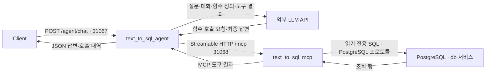
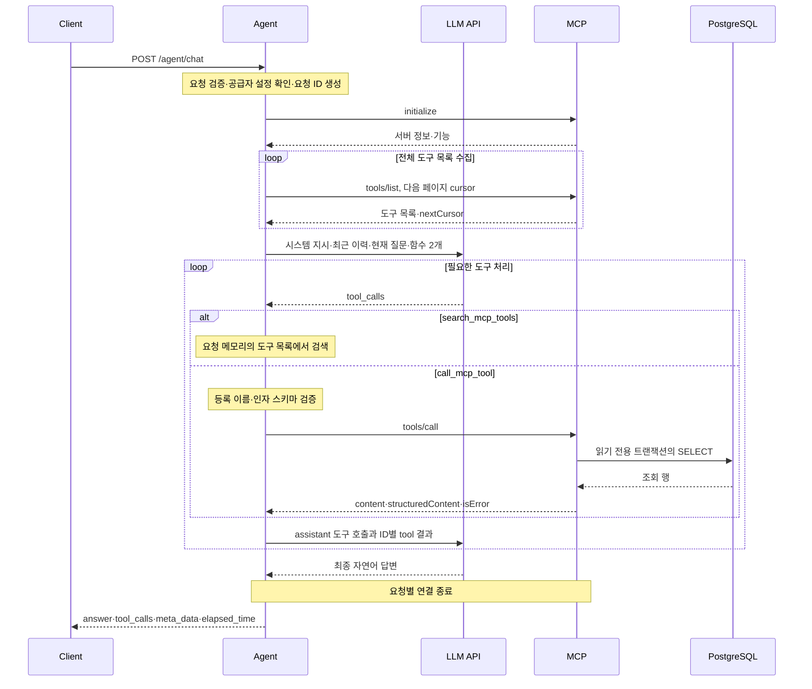

# Agent·MCP·DB 동작 과정과 데이터 흐름

이 문서는 `text_to_sql_agent`, `text_to_sql_mcp`, `text_to_sql_db`의 현재 구현을 기준으로
자연어 요청이 DB 조회와 최종 답변으로 이어지는 과정을 설명합니다. 개발·배포 시 역할과
연결 설정을 확인하기 위한 참조 문서입니다.

## 1. 전체 구성

클라이언트는 에이전트의 `POST /agent/chat`을 호출합니다. 에이전트는 외부 LLM API에
질문을 전달하고, LLM이 요청한 도구를 MCP로 호출합니다. MCP는 PostgreSQL을 조회하고,
에이전트는 조회 결과를 다시 LLM에 전달해 자연어 답변을 받아 클라이언트에 반환합니다.



| 구성 요소 | 역할 | 보관하거나 처리하는 데이터 |
| --- | --- | --- |
| Client | 자연어 질문과 필요한 대화 이력 전송 | 사용자 입력, 반환된 답변과 조회 내역 |
| `text_to_sql_agent` | HTTP 요청 처리, LLM 호출, MCP 클라이언트 실행, 결과 조립 | 요청별 대화 메시지·도구 목록·호출 내역·토큰 사용량 |
| 외부 LLM API | 질문 해석, 도구·인자 선택, 조회 결과에 근거한 답변 생성 | 에이전트가 전달한 프롬프트와 도구 결과 |
| `text_to_sql_mcp` | 컬럼별 MCP 도구 제공, 인자 검증, PostgreSQL 조회 | 스키마·컬럼 설명 메타데이터, 호출 중 조회 결과 |
| DB의 `db` 서비스 | PostgreSQL 실행, 최초 기동 시 샘플 데이터 적재·검증 | 테이블과 데이터, 호스트 `data/postgres`의 DB 상태 |

`text_to_sql_db` 프로젝트는 Compose의 `db` 서비스 하나로 구성됩니다. Dockerfile은
`postgres:17-bookworm` 기반 이미지에 기존 `seed_db` 코드와 스키마 메타데이터를 포함합니다.

DB 데이터는 `compose.yaml`이 있는 프로젝트 폴더의 `./data/postgres`를 컨테이너 내부
`/text_to_sql_db/data/postgres`에 바인드 마운트해 저장합니다. PostgreSQL의 `PGDATA`도 같은
컨테이너 경로로 지정합니다. 호스트 상대 경로의 기준은 Compose 파일 위치입니다.
DB의 `data/`는 Git과 Docker 빌드 컨텍스트에서 제외합니다.

기존 named volume에서 전환할 때 데이터 보존이 필요하면 DB를 정상 종료한 뒤 백업·복원 또는
정지 상태의 복사로 새 호스트 폴더에 데이터를 이관해야 합니다. 빈 폴더로 시작하면 새 DB를
초기화합니다. `docker compose down -v`는 이 바인드 마운트의 호스트 데이터를 삭제하지 않습니다.

에이전트는 `text_to_sql_api` 서버를 거치지 않고 LLM API에 직접 접속합니다. 기존 API와 같은
공급자 설정 이름과 모델별 호출 옵션을 사용하지만, 에이전트 자체 설정을 읽으며 기존 API의
`.env`를 자동으로 공유하지 않습니다.

## 2. 기동과 초기화

데이터 조회를 준비하는 기동 순서는 다음과 같습니다. MCP와 에이전트가 이 순서를 자동으로
조율하는 것은 아니므로 DB 데이터 검증까지 완료한 뒤 요청을 보내야 합니다.

1. **PostgreSQL 기동.** `db` 서비스가 `PGDATA`에 연결한 호스트 데이터 디렉터리를 사용합니다.
   빈 디렉터리라면 DB 계정과 데이터베이스를 초기화합니다. 기존 데이터가 있으면 그대로 로드합니다.
2. **샘플 데이터 초기화.** 빈 데이터 디렉터리에서 처음 시작할 때 PostgreSQL 초기화 스크립트가
   컨테이너 내부 Unix 소켓으로 접속해 테이블을 생성하고 샘플 데이터를 적재·검증합니다.
3. **DB 상태 확인.** Compose는 시드 작업의 미완료 표시가 없고 PostgreSQL이 TCP 연결을 받을 때
   `db`를 `healthy`로 표시합니다. 기존 DB의 샘플 데이터 검증은 수동으로 실행할 수 있습니다.
4. **MCP 기동:** 스키마와 컬럼 설명을 검증하고 컬럼마다 도구를 등록한 뒤 `/mcp`에서 대기합니다.
5. **에이전트 기동:** 자체 설정을 읽고 HTTP API를 제공합니다. LLM과 MCP 연결은 질의 요청을
   처리할 때 생성합니다.

현재 메타데이터는 **97개 테이블·1,530개 컬럼**입니다. DB는 기본 `SEED_ROWS=50`, `SEED=42`로
테이블당 50행, 총 4,850행의 가상 데이터를 생성하고, MCP는 컬럼별 도구 1,530개를 등록합니다.
이 수치는 현재 메타데이터와 기본 초기화 설정 기준입니다.

서버에 `text-to-sql-network`가 없다면 `docker network create text-to-sql-network`로 먼저 생성합니다.
DB 디렉터리에서 `.env`를 준비한 뒤 Compose로 기동합니다.

```bash
docker compose up -d
docker compose ps
```

정상 기동 후 `db`는 `healthy`로 표시됩니다. `docker compose exec -u postgres db seed-db verify`로
샘플 데이터 검증을 실행하면 성공 시
`status=verified`를 반환합니다. 샘플 테이블 생성·데이터 삽입·검증은 하나의 트랜잭션으로
처리됩니다. 최초 시드 작업 실패 시에는 `db` 로그를 확인하고 원인을 수정한 뒤
`docker compose exec -u postgres db seed-db seed`로 복구합니다. `seed-db seed --reset`은 대상
테이블의 기존 데이터를 재생성하는 수동 명령입니다. 이전 구성의 `seed` 컨테이너는 Compose 실행에
`--remove-orphans`를 추가하면 정리할 수 있습니다.

| 프로젝트 | Docker 실행 진입점 | 실행 시 확인할 내용 |
| --- | --- | --- |
| Agent | Bash 셸에서 `python3 main.py` 실행 | `docker run -it`로 접속하고 LLM 설정과 MCP 주소 전달 |
| MCP | Bash 셸에서 `python3 server.py` 실행 | `docker run -it`로 접속하고 `--env-file .env`로 DB 설정 전달 |
| DB | Compose의 `db` 서비스 | 최초 초기화는 같은 컨테이너에서 실행하며 수동 검증은 `seed-db verify` 사용 |

MCP는 기동 시 DB 테이블을 생성하지 않습니다. DB 접속은 실제 도구 호출 시 수행하므로,
MCP 초기화와 도구 목록 조회가 성공해도 DB 조회까지 성공했다는 의미는 아닙니다.

구현: [DB Compose](text_to_sql_db/compose.yaml),
[초기화·검증](text_to_sql_db/seed_db/database.py),
[MCP 도구 등록](text_to_sql_mcp/column_mcp/server.py),
[에이전트 실행](text_to_sql_agent/main.py).

## 3. 자연어 요청 한 건의 처리 과정

### 3.1 요청 접수와 연결 준비

클라이언트는 `query`, 선택적인 `history`, `provider`를 전달합니다.
에이전트는 빈 질문·지원하지 않는 공급자·잘못된 이력 형식을 검증하고 요청 ID를 생성합니다.

`provider`는 `local`, `openai`, `openrouter` 중 하나이며 기본값은 `local`입니다.
선택한 공급자의 필수 설정만 이 시점에 확인합니다. 다른 공급자의 키가 없어도 선택한 공급자의
설정이 정상이라면 요청을 처리할 수 있습니다.

에이전트는 요청별 LLM 클라이언트와 MCP 세션을 열고, SDK로 MCP `initialize`를 수행합니다.
이어 `tools/list`를 다음 페이지가 없을 때까지 호출해 도구 이름·설명·입력 스키마를 수집합니다.
도구 목록은 해당 요청의 메모리에 보관하며 중복된 도구 이름과 잘못된 스키마를 검증합니다.

### 3.2 LLM 호출과 도구 실행 반복

첫 LLM 호출에는 시스템 지시, 최근 `history[-3:]`, 현재 질문, 아래 두 함수 정의가 전달됩니다.
MCP의 1,530개 도구 전체를 LLM의 함수 목록에 넣지는 않습니다.

| LLM에 제공하는 함수 | 실행 위치와 처리 |
| --- | --- |
| `search_mcp_tools(query, limit=10, offset=0)` | 에이전트가 이미 수집한 도구 목록에서 이름·설명을 검색. 검색 자체는 MCP나 DB를 추가 호출하지 않음 |
| `call_mcp_tool(name, arguments)` | 등록된 도구 이름과 입력 스키마를 검증한 뒤 MCP SDK의 `session.call_tool()`로 실제 조회 요청 |

검색은 대소문자를 구분하지 않는 토큰 OR 부분 일치입니다. 일치 토큰 수 내림차순,
도구명 오름차순으로 정렬하며 빈 검색어는 이름순 탐색입니다. 기본 10개, 최대 50개의 도구와
입력 스키마, `total_matches`, `has_more`, `next_offset`을 반환합니다.

LLM이 반환하는 `tool_calls`는 **실행 요청**입니다. 실제 함수 실행과 MCP 네트워크 호출은
에이전트가 담당합니다. 한 LLM 응답에 여러 함수 호출이 있으면 순서대로 처리합니다.
각 결과는 호출 ID에 맞는 `role=tool` 메시지로 만들어 다음 LLM 호출에 전달합니다.

다음 LLM 호출에서는 이전 메시지에 도구 호출과 결과를 누적합니다. LLM은 추가 조회·조건 수정·
페이지 조회를 요청하거나 최종 답변을 반환할 수 있습니다. 도구 사용은 `tool_choice=auto`이므로
모든 질문이 반드시 검색과 DB 조회를 거치는 것은 아닙니다. 조건을 되묻거나 기능 한계를
설명하는 답변도 가능합니다.

### 3.3 MCP의 SQL 조회와 반환

MCP 도구 이름은 `get_{소문자 테이블명}_{소문자 컬럼명}`입니다. 예를 들어
`get_fclt_org_dlc_key_dlc_key`는 `FCLT_ORG_DLC_KEY.DLC_KEY` 조회에 고정되어 있습니다.

MCP는 도구에 고정된 테이블·컬럼과 검증한 인자로 SQL을 생성합니다. LLM이 작성한 임의 SQL을
DB에 전달하는 방식은 아닙니다. 기본 동작은 다음과 같습니다.

- `filters`: 같은 테이블의 등록된 원본 대문자 컬럼명만 사용하며 일치 조건을 AND로 결합합니다.
  `null`은 `IS NULL` 조건으로 변환합니다.
- `limit`: 기본 100, 허용 범위 1~1,000입니다. `offset`은 기본 0이고, `distinct`는 기본 `false`입니다.
- 정렬: 조회 컬럼의 오름차순이며 NULL은 마지막입니다. 기본적으로 중복과 NULL을 유지합니다.
- SQL 식별자는 `psycopg.sql.Identifier`, 필터 값과 페이지 인자는 바인딩 매개변수로 처리합니다.
- 도구 호출마다 비동기 DB 연결과 읽기 전용 트랜잭션을 사용하고, 호출 종료 시 연결을 닫습니다.
- 다음 페이지 존재 여부를 확인하려고 `limit + 1`행을 조회한 뒤 최대 `limit`개만 반환합니다.

`DB_IDENTIFIER_CASE=lower`에서는 메타데이터의 대문자 이름을 실제 PostgreSQL의 소문자
식별자로 바꿉니다. 생성기는 소문자 테이블·컬럼을 생성하며, 조회 대상 스키마는 `DB_SCHEMA`입니다.

MCP는 `ColumnResult`를 `structuredContent`와 텍스트 `content`가 있는 도구 결과로 반환합니다.
에이전트는 이 결과와 `isError`를 보존하고, 자신의 `is_error` 표시와 함께 LLM에 전달합니다.
날짜·시간은 ISO 문자열, `Decimal`은 정밀도를 보존하는 문자열, SQL NULL은 JSON `null`로 전달됩니다.

### 3.4 최종 응답과 연결 종료

LLM이 도구 호출 없는 완전한 텍스트 답변을 반환하면 에이전트는 요청별 MCP 세션과
LLM 클라이언트를 닫은 뒤 최종 JSON 응답을 반환합니다. 실패나 취소 시에도 연결을 정리합니다.
동시 요청은 서로 다른 세션·대화 메시지·호출 내역을 사용합니다.



구현: [요청 처리 루프](text_to_sql_agent/agent_server/service.py),
[MCP 클라이언트](text_to_sql_agent/agent_server/mcp_client.py),
[시스템 지시와 함수 정의](text_to_sql_agent/agent_server/prompts.py),
[SQL 생성·조회](text_to_sql_mcp/column_mcp/database.py).

## 4. 하나의 질문으로 보는 데이터 변환

아래 데이터·호출 ID·사용량·소요 시간은 형식을 설명하기 위한 예시입니다. 실제 샘플 DB에서
직접 조회한 결과가 아니며, 도구 선택과 호출 횟수도 LLM의 판단에 따라 달라집니다.

### 4.1 Client → Agent

```bash
curl -X POST 'http://AGENT_SERVER_IP:31067/agent/chat' \
  -H 'Content-Type: application/json' \
  -d '{"query":"FCLT_ORG_DLC_KEY 테이블의 DLC_KEY 값을 5개 조회해줘","history":[],"provider":"openai"}'
```

HTTP 요청 본문은 다음 형식입니다. `openai`를 선택했다면 에이전트 실행 환경의
`OPENAI_API_KEY`와 모델 설정을 사용합니다. 키를 요청 본문에 넣지 않습니다.

```json
{
  "query": "FCLT_ORG_DLC_KEY 테이블의 DLC_KEY 값을 5개 조회해줘",
  "history": [],
  "provider": "openai"
}
```

### 4.2 LLM → Agent → MCP

대표적으로 LLM이 먼저 `search_mcp_tools`를 아래 인자로 요청할 수 있습니다.

```json
{
  "query": "get_fclt_org_dlc_key_dlc_key",
  "limit": 1,
  "offset": 0
}
```

검색 결과에서 도구 정의를 확인한 뒤 `call_mcp_tool`을 다음 인자로 요청합니다.

```json
{
  "name": "get_fclt_org_dlc_key_dlc_key",
  "arguments": {
    "filters": null,
    "limit": 5,
    "offset": 0,
    "distinct": false
  }
}
```

에이전트는 `name`을 MCP 도구 이름으로, `arguments`를 해당 도구의 인자로 전달합니다.
기본 소문자 식별자 설정에서 MCP가 생성하는 SQL 형태는 다음과 같습니다.

```sql
SELECT "dlc_key"
FROM "public"."fclt_org_dlc_key"
ORDER BY "dlc_key" ASC NULLS LAST
LIMIT %s OFFSET %s;
```

이 예제의 바인딩 값은 `[6, 0]`입니다. 6번째 행은 `has_more` 계산에만 사용하고 결과에는
최대 5개의 값이 포함됩니다.

### 4.3 DB → MCP → Agent → LLM

MCP의 `structuredContent`는 다음 형태입니다.

```json
{
  "table": "FCLT_ORG_DLC_KEY",
  "column": "DLC_KEY",
  "values": ["DLC001", "DLC002", "DLC003", "DLC004", "DLC005"],
  "returned_count": 5,
  "limit": 5,
  "offset": 0,
  "distinct": false,
  "has_more": true
}
```

에이전트는 MCP 결과 전체를 `{"is_error": false, "result": ...}` 구조의 JSON 문자열로
직렬화해 `role=tool`, 해당 `tool_call_id`와 함께 LLM에 전달합니다. 따라서 최종 답변을
작성하는 LLM은 실제 조회된 컬럼 값과 페이지 정보를 받습니다.

### 4.4 Agent → Client

다음은 최종 응답의 **축약 예시**입니다. 설명의 중복을 줄이기 위해 검색 호출 기록과 MCP의
텍스트 `content`를 생략했습니다. 실제 응답에는 실행한 검색·조회 기록이 모두 포함되고,
조회 기록의 `result`는 MCP의 `content`, `structuredContent`, `isError` 등을 보존합니다.

```json
{
  "status": "success",
  "msg": "success",
  "data": {
    "answer": "조회한 DLC_KEY 값은 DLC001, DLC002, DLC003, DLC004, DLC005입니다. 전체 데이터 중 앞의 5개입니다.",
    "tool_calls": [
      {
        "id": "call_query_example",
        "function_name": "call_mcp_tool",
        "mcp_tool_name": "get_fclt_org_dlc_key_dlc_key",
        "arguments": {
          "name": "get_fclt_org_dlc_key_dlc_key",
          "arguments": {"filters": null, "limit": 5, "offset": 0, "distinct": false}
        },
        "result": {
          "structuredContent": {
            "table": "FCLT_ORG_DLC_KEY",
            "column": "DLC_KEY",
            "values": ["DLC001", "DLC002", "DLC003", "DLC004", "DLC005"],
            "returned_count": 5,
            "limit": 5,
            "offset": 0,
            "distinct": false,
            "has_more": true
          },
          "isError": false
        },
        "is_error": false
      }
    ]
  },
  "meta_data": [
    {
      "request_id": "example-request-id",
      "provider": "openai",
      "model_name": "gpt-6-luna",
      "llm_calls": 3,
      "question_token": 1000,
      "answer_token": 120
    }
  ],
  "elapsed_time": 1.2
}
```

`llm_calls=3`은 검색 선택·조회 선택·최종 답변의 세 차례 호출을 가정한 값입니다.
`question_token`과 `answer_token`은 응답을 받은 LLM 호출들의 사용량 합계이며, 공급자가
사용량을 제공하지 않은 호출은 0으로 집계합니다. `llm_calls`에는 에이전트가 시도한 호출이
집계되며 SDK 내부의 재시도 횟수는 별도 호출 수로 노출되지 않습니다.

요청·응답 모델: [schemas.py](text_to_sql_agent/agent_server/schemas.py).

## 5. LLM에 전달되는 정보와 상태의 수명

| 시점 | LLM에 전달되는 정보 |
| --- | --- |
| 첫 호출 | 시스템 지시, 최근 대화 메시지 최대 3개, 현재 `query`, 검색·호출 함수 정의 |
| 도구 검색 후 | 검색한 MCP 도구의 이름·설명·입력 스키마와 검색 페이지 정보 |
| MCP 조회 후 | 도구 인자, MCP 조회 값, 반환 개수·페이지 정보, 도구 오류 여부 |
| 추가 호출 | 앞서 누적한 대화·도구 호출·도구 결과와 새 결과 |

전체 도구 목록은 에이전트 메모리에 수집하지만 LLM에는 검색 결과에 포함된 정의만 전달합니다.
LLM 함수 호출이 DB 접속으로 이어지려면 에이전트의 등록 도구·인자 검증을 통과해야 합니다.
DB 접속 계정과 비밀번호는 MCP의 DB 연결에 사용하고, LLM API 키는 SDK 인증에 사용합니다.
이 인증 정보를 시스템 지시나 질문 데이터에 추가하지 않습니다.

에이전트는 대화 이력과 호출 내역을 영구 저장하지 않습니다. 다음 질문의 문맥이 필요하면
클라이언트가 `history`를 다시 보내야 합니다. 이력은 `user`·`assistant` 메시지의 오래된 순서
배열이며, 최근 **메시지 3개**만 사용합니다. 현재 질문은 이 제한과 별도로 추가됩니다.
요청 중 누적되는 도구 결과에는 이 3개 제한을 적용하지 않습니다.

클라이언트 응답에는 최종 답변과 구조화된 호출 기록이 포함됩니다. 에이전트가 LLM의 중간
추론 내용을 별도 응답 필드로 수집하거나 반환하지는 않습니다.

## 6. 컨테이너 연결과 포트 설정

### 6.1 포트와 바인딩

| 경로 | 접속 주소·포트 | 프로토콜 |
| --- | --- | --- |
| Client → Agent | `http://AGENT_SERVER_IP:31067/agent/chat` | HTTP JSON |
| Agent → MCP | `http://MCP_SERVER_IP:31068/mcp` 또는 `http://mcp-server:31068/mcp` | MCP Streamable HTTP |
| MCP → DB, 호스트 공개 포트 경유 | `DB_SERVER_IP:31066` | PostgreSQL |
| MCP → DB, 같은 Docker 네트워크 | `db:5432` | PostgreSQL |

세 프로젝트의 Dockerfile은 `EXPOSE 80`을 선언하지만 실제 수신 포트나 공개 포트를 80으로
바꾸지는 않습니다. Agent는 기본 `31067`, MCP는 `31068`에서 수신합니다. PostgreSQL은
컨테이너 내부 `5432`에서 수신하고 Compose가 호스트 `31066`으로 고정 공개합니다.
Compose의 공개 포트는 `DB_PORT` 환경변수로 변경하지 않습니다. MCP의 `DB_PORT`는 접속 대상
포트 설정으로 계속 사용할 수 있습니다. 호스트 포트를 이용할 때 HTTP 서비스의 매핑은 각각
`31067:31067`, `31068:31068`입니다.

MCP의 `.env.example`에 있는 `DB_PORT=5432`는 같은 Docker 네트워크의 DB에 접속할 때
사용합니다. 호스트 공개 포트로 DB에 접속할 때는 MCP의 `.env`에서 `DB_PORT=31066`을 설정합니다.

호스트에서 Python으로 직접 실행하는 Agent·MCP의 기본 바인딩은 `127.0.0.1`입니다.
Docker 이미지에는 `AGENT_HOST=0.0.0.0`, `MCP_HOST=0.0.0.0`이 설정돼 있어 컨테이너의
모든 IPv4 인터페이스에서 수신합니다. `.env.example`에서 이 HOST 항목을 생략해도 기본값은
적용됩니다. `--env-file`이나 `-e`로 전달한 값은 이미지 기본값보다 우선합니다.

컨테이너 내부의 `localhost`와 `127.0.0.1`은 **해당 컨테이너 자신**입니다. 서로 다른
컨테이너를 연결할 때는 같은 서버에서 실행하더라도 목적지 컨테이너 이름 또는 접근 가능한
서버 주소를 사용합니다. `0.0.0.0`은 수신 바인딩 값이며 클라이언트의 접속 목적지로 쓰지 않습니다.

### 6.2 같은 Docker 네트워크에서 연결

DB Compose는 미리 만든 외부 네트워크 `text-to-sql-network`에 연결합니다. Agent와 MCP도
같은 네트워크에 연결하고 MCP 컨테이너 이름을 `text_to_sql_mcp`로 지정합니다.

| 설정 위치 | 값 |
| --- | --- |
| Agent | `MCP_URL=http://text_to_sql_mcp:31068/mcp` |
| MCP | `DB_HOST=text_to_sql_db`, `DB_PORT=5432` |
| MCP | DB 생성 때 사용한 `DB_NAME`, `DB_USER`, `DB_PASSWORD`, `DB_SCHEMA` |

MCP는 DB의 컨테이너 내부 포트 `5432`에 직접 접속합니다. MCP 예제의 `MCP_ALLOWED_HOSTS`에는
`text_to_sql_mcp:31068`이 포함돼 있습니다. 컨테이너나 네트워크 이름을 변경하면 접속 설정에도 반영합니다.

### 6.3 서버 공개 포트로 연결

서로 다른 서버에서 실행하거나 서버 IP의 공개 포트를 경유한다면 다음 값을 사용합니다.
IP와 인증 정보의 자리표시자는 실제 실행 환경의 값으로 교체해야 합니다.

Agent 실행 환경:

```dotenv
MCP_URL=http://MCP_SERVER_IP:31068/mcp
OPENAI_API_KEY=<OPENAI_API_KEY>
```

MCP 실행 환경:

```dotenv
DB_HOST=DB_SERVER_IP
DB_PORT=31066
DB_NAME=<DB_NAME>
DB_USER=<DB_USER>
DB_PASSWORD=<DB_PASSWORD>
DB_SCHEMA=public
```

이와 함께 MCP의 기존 `MCP_ALLOWED_HOSTS`에 실제 접속 주소인 `MCP_SERVER_IP:31068`을 추가합니다.
해당 환경변수는 기본 목록을 대체하므로 필요한 기존 항목도 함께 유지합니다. 에이전트의 서버 간
호출에는 Origin 헤더를 추가하지 않으며, 이 경우 기본 MCP 설정은 Origin 없이도 요청을 받습니다.

MCP 컨테이너의 포트는 `-p 31068:31068`로 공개합니다. DB Compose의 기본 공개 바인딩은
`127.0.0.1`이므로 서버 IP로 DB를 접속하려면 **DB 프로젝트 쪽** `DB_HOST`에 서버의 수신 IP 또는
`0.0.0.0`을 설정합니다. 서버 간 주소와 포트가 네트워크에서 도달 가능해야 합니다.

같은 이름인 `DB_HOST`도 사용 위치에 따라 의미가 다릅니다.

| 설정 위치 | `DB_HOST`의 의미 |
| --- | --- |
| DB 프로젝트의 Compose | PostgreSQL 포트를 공개할 **호스트의 수신 IP** |
| DB 프로젝트의 Python 직접 실행 | 초기화·검증 프로그램이 **접속할 PostgreSQL 주소** |
| MCP 프로젝트 | MCP가 **접속할 PostgreSQL 주소** |

따라서 Compose용 `DB_HOST=0.0.0.0`을 MCP의 DB 접속 주소로 복사하지 않습니다.
샘플 데이터 초기화는 `db` 컨테이너 내부의 Unix 소켓을 사용합니다.

각 프로젝트는 자체 `.env`를 읽으며 프로세스 환경변수가 우선합니다. 에이전트는 LLM 공급자에
따라 아래 정보를 필요로 합니다. 선택한 모델이 네이티브 함수 호출을 지원해야 합니다.

| `provider` | 주요 설정 | 현재 기본 모델 |
| --- | --- | --- |
| `local` | `LLM_API_BASE`, `LLM_MODEL_NAME` | `DeepSeek-V4-Flash-0731` |
| `openai` | `OPENAI_API_KEY`, `OPENAI_LLM_MODEL_NAME` | `gpt-6-luna` |
| `openrouter` | `OPENROUTER_API_KEY`, `OPENROUTER_LLM_MODEL_NAME` | `deepseek/deepseek-v4-flash-0731` |

## 7. 조회 범위와 오류 처리

### 7.1 지원 범위

현재 MCP의 범위는 **단일 컬럼 조회, 같은 테이블의 일치 필터, 중복 제거, 페이지 조회**입니다.
범용 SQL 실행·행 단위 JOIN·임의 SQL 집계를 수행하는 도구는 제공하지 않습니다.
에이전트도 이 범위를 확장하는 DB 직접 연결이나 SQL 실행 경로를 갖고 있지 않습니다.

각 컬럼은 독립 정렬되므로 서로 다른 조회 배열의 같은 인덱스를 같은 DB 행으로 연결할 수
없습니다. `has_more=true`는 아직 조회하지 않은 값이 있다는 의미이며, 에이전트가 모든 페이지를
자동으로 선조회하지는 않습니다. LLM이 필요에 따라 추가 페이지를 요청합니다.

시스템 지시는 이번 요청의 성공한 조회 결과를 DB 사실의 근거로 사용하고, 부분 조회·오류·
기능 한계를 설명하도록 요구합니다. 자연어 답변의 정확성을 프로그램이 별도로 증명하는 것은
아니므로 원본 `tool_calls`와 `has_more`, `is_error`도 함께 확인할 수 있게 반환합니다.

### 7.2 반복·시간 제한

| 설정 | 기본값 | 적용 범위 |
| --- | --- | --- |
| `AGENT_MAX_LLM_ROUNDS` | 12 | 최종 답변을 포함한 LLM 호출 횟수 |
| `AGENT_MAX_TOOL_CALLS` | 32 | 검색·조회·실패를 포함한 함수 호출 횟수 |
| `AGENT_REQUEST_TIMEOUT_SECONDS` | 180초 | 전체 요청 작업과 연결 처리 |
| `LLM_TIMEOUT_SECONDS` | 60초 | LLM SDK 요청 타임아웃 |
| `MCP_TIMEOUT_SECONDS` | 60초 | MCP HTTP 클라이언트와 세션 응답 대기 |
| MCP의 `DB_CONNECT_TIMEOUT` | 10초 | PostgreSQL 연결 |
| MCP의 `DB_STATEMENT_TIMEOUT_MS` | 30,000ms | 호출에서 실행하는 SQL |

LLM SDK는 최대 2회 재시도하며 전체 요청 제한 시간 안에서 동작합니다. 요청 제한이나 취소가
발생하면 진행 중 작업을 취소하고 연결을 정리하므로, 응답 시점에는 정리 시간이 더해질 수 있습니다.

### 7.3 오류의 전달

잘못된 함수 인자·등록되지 않은 도구·MCP의 `isError=true` 결과는 도구 오류로 LLM에 전달해
인자를 정정할 기회를 줍니다. 연결·프로토콜 실패처럼 조회를 이어갈 수 없는 오류는 요청을 종료합니다.

| HTTP 상태 | 의미 |
| --- | --- |
| `200` | LLM의 최종 답변 생성 완료. 성공한 조회 설명뿐 아니라 조건 확인 질문이나 조회 실패·기능 한계 설명일 수도 있음 |
| `422` | 요청 형식 오류, 빈 질문, 잘못된 공급자·대화 이력 |
| `500` | 선택한 LLM 공급자의 필수 접속 설정·키·모델 설정 오류 |
| `502` | LLM/MCP 통신·응답 오류, LLM 거절·불완전 응답, 반복 횟수 한도 초과 등 |
| `504` | 에이전트 전체 요청 제한 시간 초과 |

처리 중 실패한 응답은 `status=error`, `data.answer=null`이고, 중단 전까지의
`data.tool_calls`와 메타데이터를 포함합니다. 요청 형식 검증 실패는 `data=null`입니다.
로그에는 요청 ID·처리 단계·소요 시간·호출 수와 오류 유형을 기록하며, 상위 API의 원시
인증 오류 메시지나 API 키를 로그·오류 응답에 포함하지 않습니다.

`GET /health`는 에이전트 프로세스의 `{"status":"ok"}`만 확인합니다. LLM·MCP·DB 연결,
DB 초기화 완료, 데이터 조회 성공을 검사하지 않습니다.

## 8. 검증 범위와 관련 자료

현재 구현에서는 모의 LLM과 실제 HTTP 테스트 MCP 서버로 요청·함수 결과 전달, 도구 목록
페이지 처리, 오류 복구, 한도·시간 초과·취소, 동시 요청 세션 분리와 연결 종료를 검증했습니다.
기존 MCP의 1,530개 도구 입력 스키마도 에이전트에서 검증한 이력이 있습니다.

이 검증은 **실제 세 프로젝트의 컨테이너와 외부 LLM·PostgreSQL을 모두 연결한 전체 실행**을
완료했다는 의미는 아닙니다. 해당 Docker 전체 연동은 현재 작업 환경에서 검증되지 않았으며,
이 문서의 예제 값도 실제 LLM·DB 조회 결과로 간주하지 않습니다.

- [Agent 설치·실행과 API](text_to_sql_agent/README.md)
- [MCP 설치·도구 규약](text_to_sql_mcp/README.md)
- [MCP 상세 실행 가이드](text_to_sql_mcp/run_guide.md)
- [DB 초기화·가상 데이터·검증](text_to_sql_db/README.md)
- [Agent 설정](text_to_sql_agent/agent_server/config.py)
- [LLM 공급자별 호출](text_to_sql_agent/agent_server/llm.py)
- [MCP 접속·시간 제한 설정](text_to_sql_mcp/column_mcp/config.py)
